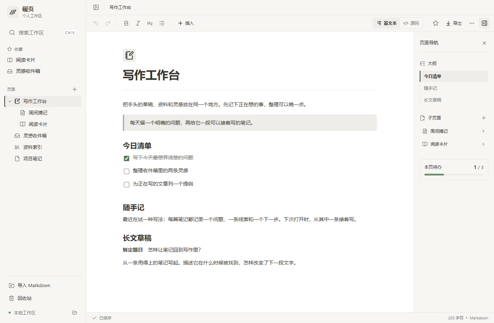

# 砚页 YanYe

砚页 YanYe 是一款面向 Windows 的开源集成办公协作软件。它从 Typora 的连续 Markdown 写作出发，加入 Notion 的页面化组织能力，并计划把文档、电子表格、多维表格、流程图、白板、演示文稿和实时协作放进同一个工作区。

当前可运行版本是 Windows x64 本地 Markdown 工作区。团队可以从这里查看各阶段的功能、交互和验收条件。[产品设计说明](docs/PRODUCT_SPEC.md) · [技术架构说明](docs/ARCHITECTURE.md) · [界面与动效规范](docs/STYLE_SPEC.md) · [MIT 许可证](LICENSE)



## 产品取舍

- Typora 的部分聚焦于 Markdown 双向编辑、富文本和源码模式切换、快捷键写作、代码块、表格与任务清单。
- Notion 的部分聚焦于页面树、子页面、收藏、全文搜索、回收站、页面移动、页面目录和任务进度。
- 米纸色侧栏放页面树，白色正文区用于编辑，右侧显示大纲、子页和待办进度。
- 数据默认保存在本机，保存过程使用临时文件写入后替换，应用关闭前会等待最后一次保存完成。

## 已实现能力

- Markdown 源码和富文本双向切换
- 标题、粗体、斜体、引用、代码、分隔线、表格、图片和任务清单
- `/` 块命令菜单，可插入文本、标题、待办、引用、代码块、分隔线、表格和子页面
- 工作区页面树，可折叠、收藏、移动页面、移入回收站和恢复页面
- 页面标题与正文的全文搜索
- Markdown 导入与导出
- 右侧页面目录、子页面列表和任务完成进度
- `Ctrl+K` 搜索、`Ctrl+N` 新建页面、`Ctrl+S` 立即保存
- Electron 桌面窗口使用上下文隔离。按 Ctrl 单击文档中的 HTTP 或 HTTPS 链接可在系统浏览器打开。

## 集成办公产品路线

| 模块 | 目标能力 | 当前状态 |
| --- | --- | --- |
| 文档 | Markdown、富文本、Word 导入导出、批注、版本历史 | Markdown MVP |
| 电子表格 | 公式、筛选、排序、图表、Excel 导入导出 | 规划中 |
| 多维表格 | 字段类型、视图、关联、看板和自动化 | 规划中 |
| 白板与流程图 | 节点、连线、泳道、模板、SVG 和 PNG 导出 | 规划中 |
| 演示文稿 | 幻灯片、主题、演讲者备注、PDF 和 PPTX 导出 | 规划中 |
| 协作 | 实时光标、评论、权限、离线队列、冲突合并 | 规划中 |

产品设计采用先稳定本地格式，再接入同步服务的顺序。文档和表格模块共享工作区、权限、评论和历史记录模型，避免每个模块形成孤立的数据系统。

## 开发运行

在 Windows 上准备 Node.js 24 和 pnpm 11.25.0，然后运行以下命令。

```powershell
git clone https://github.com/ZhaoZan010903/yanye-office.git
cd yanye-office
pnpm install --frozen-lockfile
pnpm start
```

只启动 Vite 开发服务器可以使用 `pnpm dev`。桌面端需要使用 Electron 启动，推荐使用 `pnpm start`。

## 验证与打包

```powershell
pnpm test
pnpm test:desktop
pnpm package:win
```

`pnpm test` 覆盖工作区数据结构和页面树操作。`pnpm test:desktop` 会启动真实 Electron 窗口，验证双向 Markdown、块命令、待办、表格、全文搜索、页面移动与恢复、导入导出、关窗保存和重启加载。`pnpm package:win` 会生成 Windows x64 便携目录，主程序位于 `release\YanYe-win32-x64\YanYe.exe`。

## 本地数据

默认工作区文件位于 `%APPDATA%\YanYe\workspace.json`。开发和自动化验证可以通过 `YANYE_PROFILE` 指定独立目录。

## 目录结构

```text
electron/       Electron 主进程、预加载脚本和本地存储
shared/         页面树与工作区数据模型
src/            React 界面、编辑器、块命令和样式
scripts/        图标生成与 Windows 打包脚本
test/           工作区单元测试和桌面端流程测试
docs/           产品设计、技术架构和视觉规范
```

## 当前边界

- 含 frontmatter、脚注、指令块或原始 HTML 的 Markdown 会进入源码优先模式，以保留原始文本。
- 当前版本是本地单机工作区，尚未加入账户、云同步、多人协作和版本历史。
- Windows 产物是便携目录，尚未生成代码签名安装包。
