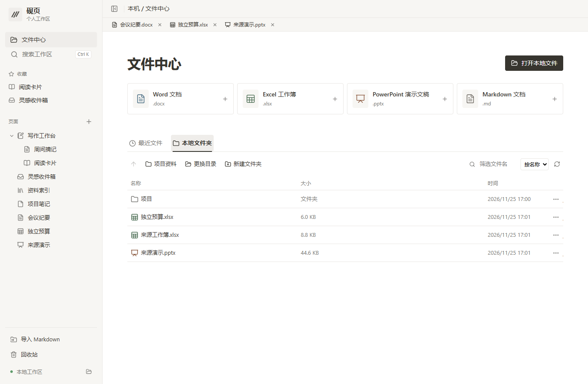

# 砚页 YanYe

砚页是一款面向 Windows 的开源本地办公软件。名字取自砚台与书页。你可以在同一棵页面树里写 Markdown、算预算、排项目进度、画流程，再把文档大纲整理成演示文稿。

**0.3.0 从文件中心启动。** 在「本地文件夹」选择电脑上的目录，即可新建 Word 文档、Excel 工作簿、PowerPoint 演示文稿或 Markdown 文件。打开已有文件用 `Ctrl+O`，在绑定文件的编辑器中用 `Ctrl+S` 写回磁盘，`Ctrl+Shift+S` 另存。侧栏继续提供原有工作区、白板和多维表格。[产品设计说明](docs/PRODUCT_SPEC.md) · [技术架构说明](docs/ARCHITECTURE.md) · [界面与动效规范](docs/STYLE_SPEC.md)



## 在本机可以做什么

| 页面 | 编辑能力 | 文件交换 |
| --- | --- | --- |
| Word 文档 | 按文字处理流程设置字体、字号、段落样式与对齐，操作表格、插图、查找替换和分页符，设置纸型、方向与边距 | 新建、打开、保存 DOCX，按纸型导出 PDF |
| Markdown 文档 | 在富文本与源码间切换，通过 `/` 插入块，沿标题大纲定位，勾选待办 | 导入和导出 Markdown |
| 电子表格 | 选区复制与粘贴、样式与对齐、合并与拆分、跨表公式、条件计算、排序筛选、冻结窗格、柱状图 | CSV 交换二维值，XLSX 保存工作表、公式、支持的样式和合并区域 |
| 多维表格 | 自定义字段、记录详情、同表关联及数值计算，同一组记录可切换表格、看板、日历 | JSON 备份保留字段结构与关联，CSV、XLSX 用于交换二维数据 |
| 流程图与白板 | 放置流程步骤、判断、起止、泳道、便签与文字，手绘、拖动节点、标注连线 | JSON 可恢复编辑，SVG、PNG 导出画面，Mermaid 导出流程结构 |
| 演示文稿 | 从文档生成幻灯片，插入独立文本框，拖动或设置位置、尺寸、字号与颜色，编辑配图与演讲者备注，按 `F5` 放映 | 打开和保存 PPTX，可编辑的文本框写入文件，也支持逐页 16∶9 PDF |

工作区支持子页面、收藏、移动与回收站恢复。文档保持连续书写的版式，电子表格和画布可使用更宽的操作区域。办公文件的兼容范围和各模块的使用限制见[产品设计说明](docs/PRODUCT_SPEC.md)。

## 管理磁盘文件

文件中心列出所选目录中的文件和子目录，支持新建目录、重命名、移动以及移入 Windows 系统回收站。「最近文件」可以打开选定目录以外使用过的文件。顶部标签切换已打开的文件。编辑器底部显示文件是否还有未写回的修改。砚页自动保留工作区草稿，写回 Office 文件由「保存文件」触发。

首次写回外部 Office 文件时可以选择另存副本。覆盖前的上一份原件保存在 `%APPDATA%\YanYe\file-backups`，在已绑定页面的「页面操作 → 另存上次原件」可取回为独立文件。如果原文件被其他程序改过，砚页会提示改用另存。旧版二进制 DOC、XLS、PPT 和加密文件暂不支持直接编辑。

## 在 Windows 上运行

开发环境使用 Node.js 24 和 pnpm 11.25.0。在 PowerShell 运行以下命令。

```powershell
git clone https://github.com/ZhaoZan010903/yanye-office.git
cd yanye-office
pnpm install --frozen-lockfile
pnpm start
```

`pnpm start` 构建界面并启动 Electron。运行 `pnpm dev` 可以单独启动 Vite 开发服务器。文件对话框和本地工作区存储由桌面主进程提供。

## 验证与打包

```powershell
pnpm test
pnpm test:desktop
pnpm package:win
```

`pnpm test` 运行模型和格式交换的单元测试。`pnpm test:desktop` 构建应用并运行 Electron 桌面流程测试。打包后保留整个 `release\YanYe-win32-x64` 目录，双击其中的 `YanYe.exe` 即可运行。

已安装 Microsoft Office 的 Windows 开发机还可验证真实文件往返。在 PowerShell 7 中运行下列两条命令，测试会建立临时目录和隔离的砚页工作区。

```powershell
node test/word-desktop.mjs release/YanYe-win32-x64/YanYe.exe
.\test\microsoft-interop.ps1 -Executable .\release\YanYe-win32-x64\YanYe.exe
```

依赖安装完成后，也可以离线打包。在 PowerShell 设置 `$env:YANYE_ELECTRON_ZIP_DIR` 指向保存对应版本 Electron Windows x64 ZIP 的目录，再执行 `pnpm package:win`。打包脚本会使用已安装 Electron 包中的 SHA-256 校验和核对该文件。

## 本地数据

工作区默认写入 `%APPDATA%\YanYe\workspace.json`。要备份全部页面，可在应用关闭后复制该文件。便携程序和工作区数据分开存放。开发与测试可使用 `YANYE_PROFILE` 指定独立的数据目录。当前工作区上限为 24 MiB，嵌入的幻灯片图片也占用此空间。

## 开发路线

| 阶段 | 范围 |
| --- | --- |
| 0.1 · 本地写作 | Markdown 编辑、页面树、搜索、回收站与自动保存 |
| 0.2 · 本地办公 | 电子表格、多维表格、流程图与白板、演示文稿 |
| 0.3 · 本地文件与 Office 编辑 | 文件中心、DOCX 文字处理与 PDF、XLSX 选区与格式、PPTX 文件读写、多文件标签与原件保护 |
| 后续本地里程碑 | 扩展复杂 Office 格式兼容、文档审阅、数据分析和工作区备份与恢复 |
| 最后 · 团队文档协作 | 全部本地里程碑完成后，再开发账号、共享权限、评论、多人同步与冲突处理 |

本项目按 [MIT 许可证](LICENSE) 开源。
