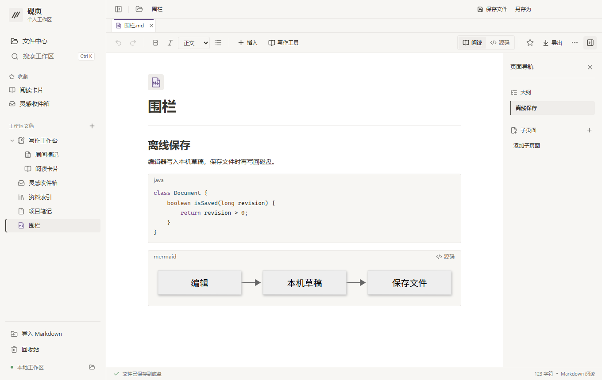

# 砚页 YanYe

砚页是一款面向 Windows 的开源本地办公软件。名字取自砚台与书页。你可以在同一棵页面树里写 Markdown、算预算、排项目进度、画流程，再把文档大纲整理成演示文稿。

**0.7.0 使用 Tauri 2 和 Windows WebView2，在本机离线工作。** 在文件中心用 `Ctrl+O` 打开 DOCX、XLSX、XLSM、PPTX、PDF、Markdown 或 TXT。选择侧栏「工作区文稿」旁的加号，然后选「电子文档」，即可断网写作。电子文档自动保存到本机，导出一份 Markdown 可交给别人。磁盘文件用 `Ctrl+S` 写回，用 `Ctrl+Shift+S` 另存。[产品设计说明](docs/PRODUCT_SPEC.md) · [技术架构说明](docs/ARCHITECTURE.md) · [界面与动效规范](docs/STYLE_SPEC.md)


在 Word 文档中可以把正文设为纵向、附表设为横向，逐条接受或拒绝文字修订。在电子表格中可以创建原生数据透视表，打开 XLSM 查看可读的 VBA 模块并保留宏工程。演示稿支持为对象安排动画、设置触发顺序和运动路径。[本地办公功能、REA 样本与原应用回读](docs/LOCAL_OFFICE.md)

Markdown 的「阅读」和「源码」均可编辑。在「阅读」中直接修改排版后的文稿，在「源码」中修改原始标记。输入三个反引号与语言名后按 Enter 创建围栏，选择 Java 可高亮，选择 Mermaid 可在图形和图源之间切换。磁盘 Markdown 达到 256 KiB 时优先打开源码。



0.7 支持脚注往返、引用式链接与图片，以及 `flow`、`sequence` 两类图形围栏。源码视图可直接编辑整页 Markdown，提供标题层级、语法着色、软换行、行号与光标位置。[查看源码视图](docs/markdown-source-windows.png) · [查看文件样本和兼容说明](docs/LOCAL_OFFICE.md)

## 产品设计

文件中心管理磁盘目录、最近文件和打开的文件标签。「工作区文稿」在本机项目树中组织电子文档、电子表格、演示稿、多维表格和流程图。以后可以由所有者把文稿发布到共享空间，团队协作排在本地功能之后。

| 设计文档 | 回答的问题 |
| --- | --- |
| [产品需求与验收](docs/PRODUCT_SPEC.md) | 每类内容解决什么任务？打开、导入、引用、导出和恢复分别会改变什么？ |
| [Windows 客户端技术选型与架构](docs/ARCHITECTURE.md) | 现有编辑器如何复用？本地增量存储、索引、文件兼容和旧工作区迁移如何实现？ |
| [性能预算与基准](docs/PERFORMANCE.md) | 怎样测量启动、输入、滚动、打开、保存和内存？哪些是目标，哪些已有实测？ |

## 在本机可以做什么

| 页面 | 编辑能力 | 文件交换 |
| --- | --- | --- |
| Word 文档 | 分别设定中西文字体、中文字号、字色和荧光标记，编辑上下标、首行缩进、段前段后间距和对齐。支持表格、插图、查找替换、分页与页边距，首页及奇偶页页眉页脚、当前页和总页数域；在正文选区新增、定位和删除署名批注 | 新建、打开、保存 DOCX，按纸型导出 PDF |
| PDF 阅读器 | 缩略图、跳页、缩放、选择和查找带文字层的内容，扫描件逐页阅读。字体、字符映射与解码器随包提供 | 写入标准便签与选区高亮，旋转、调序、按范围提取或追加另一份 PDF 后保存独立副本 |
| TXT 编辑器 | 查找替换、跳行、书签、行排序、去重、移动行、行列位置和撤销。自动识别 UTF-8 和带标记的 UTF-16，无法确定时选择编码并预览 | 保留 BOM 和换行，包括同一文件中的混合换行。GBK / GB18030 可按原编码保存，遇到无法无损编码的字符可另存 UTF-8 副本 |
| Markdown 文档 | 在可编辑的阅读视图与源码间切换，通过 `/` 插入块，沿标题大纲定位，勾选待办，查找替换、专注及打字机模式、离线公式与 Mermaid 图 | 导入和导出 Markdown |
| 电子表格 | 选区字体、字号、下划线、删除线、字色和底色、边框、水平及垂直对齐，常用数字格式。支持合并拆分、跨表公式、排序筛选、冻结窗格、下拉验证、数值条件格式、条件统计与查找函数、带图例及配色的多系列条形图 | CSV 交换二维值，XLSX 保存工作表、公式、支持的样式、合并区域、规则及原生可编辑图表 |
| 多维表格 | 自定义字段、记录详情、同表关联及数值计算，同一组记录可切换表格、看板、日历 | JSON 备份保留字段结构与关联，CSV、XLSX 用于交换二维数据 |
| 流程图与白板 | 放置流程步骤、判断、起止、泳道、便签与文字，手绘、拖动节点、标注连线 | JSON 可恢复编辑，SVG、PNG 导出画面，Mermaid 导出流程结构 |
| 演示文稿 | 从文档生成幻灯片，插入独立文本框，拖动或设置位置、尺寸、字号与颜色，编辑配图、备注、彩色形状与图层，设置单击或定时切换，按 `F5` 放映 | 打开和保存 PPTX，可编辑的文本框写入文件，也支持逐页 16∶9 PDF |

工作区支持子页面、收藏、移动与回收站恢复。文档保持连续书写的版式，电子表格和画布可使用更宽的操作区域。办公文件的兼容范围和各模块的使用限制见[产品设计说明](docs/PRODUCT_SPEC.md)。

## 管理磁盘文件

文件中心列出所选目录中的文件和子目录，支持新建目录、重命名、移动以及移入 Windows 系统回收站。「最近文件」可以打开选定目录以外使用过的文件。顶部标签切换已打开的文件。编辑器底部显示文件是否还有未写回的修改。砚页自动保留工作区草稿，写回 Office 文件由「保存文件」触发。

首次写回外部 Office 文件时可以选择另存副本。覆盖前的上一份原件保存在 `%APPDATA%\YanYe\file-backups`，在已绑定页面的「页面操作 → 另存上次原件」可取回为独立文件。如果原文件被其他程序改过，砚页会提示改用另存。旧版二进制 DOC、XLS、PPT 和加密文件暂不支持直接编辑。

## 在 Windows 上运行

安装 Windows 10/11 x64、Microsoft Edge WebView2 Runtime、Node.js 24、pnpm 11 和 Rust 稳定版。常规开发环境使用 Visual Studio Build Tools 的 C++ 桌面工作负载。[Tauri Windows 环境说明](https://v2.tauri.app/start/prerequisites/)

```powershell
git clone https://github.com/ZhaoZan010903/yanye-office.git
cd yanye-office
pnpm install --frozen-lockfile
pnpm start
```

`pnpm start` 或 `pnpm dev` 启动 React 热更新与 Tauri 原生窗口。Rust 管理文件对话框、工作区和磁盘文件。可用 `pnpm dev:renderer` 单独运行 Vite 进行组件开发。

## 验证与打包

```powershell
pnpm typecheck
pnpm test
cargo test --manifest-path src-tauri/Cargo.toml
pnpm package:win
pnpm test:desktop
```

`package:win` 生成当前用户安装包和便携 ZIP，均在 `release` 下按版本命名。解压便携包后运行同目录中的 `YanYe.exe`。两种发行方式都使用系统 WebView2，离线机器需提前安装该运行时。安装版在 Windows「打开方式」中注册支持的格式。

`test:desktop` 在独立的临时用户目录里运行已构建的 Windows 程序，核对旧 SQLite、Markdown 磁盘保存与异常退出恢复。可传入 exe 的绝对路径指定构建。格式变更可按需运行原应用回读用例，性能基准由开发者手动运行。[0.5 桌面测试与历史源码](https://github.com/ZhaoZan010903/yanye-office/tree/9b14908e6a5fdbee76efbd9af0a41c862f01b0d7)

## 本地数据

本地工作区保存到 `%APPDATA%\YanYe\workspace.sqlite`。升级首次启动时自动导入同目录下 schema 1、2、3 的旧 `workspace.json`，并在事务中核对页面、修订和文件绑定。原 JSON 保留作升级前的快照。编辑器显示「已保存到本机」时，该修订已提交。从任务管理器意外结束砚页后，下次打开可恢复到最后一个已确认修订。

备份时先正常退出砚页，再复制整个 `%APPDATA%\YanYe` 文件夹，包含数据库及其伴随文件、文件索引和上次覆盖前的原件。磁盘上的源文件仍放在用户选择的目录，也需要备份。开发与测试可用 `YANYE_PROFILE` 指定独立目录。当前工作区的逻辑容量为 24 MiB、最多 2,000 页，文件中心单文件上限为 32 MiB。

## 开发路线

| 阶段 | 范围 |
| --- | --- |
| 0.1 · 本地写作 | Markdown 编辑、页面树、搜索、回收站与自动保存 |
| 0.2 · 本地办公 | 电子表格、多维表格、流程图与白板、演示文稿 |
| 0.3 · 本地文件与 Office 编辑 | 文件中心、DOCX 文字处理与 PDF、XLSX 选区与格式、PPTX 文件读写、多文件标签与原件保护 |
| 0.4 · 断网文稿与文件阅读 | 电子文档增量保存、异常退出恢复、旧工作区迁移、PDF 阅读、TXT 编辑及 Word / Excel 排版增强 |
| 0.5 · 本地格式编辑 | 原版式文字替换、页眉页脚和域、原生图表与规则、形状与放映切换、PDF 页面整理与批注、Markdown 和文本工具 |
| 0.6 · 本地编辑体验 | Tauri 与 Rust 宿主、两种可编辑 Markdown 视图、语言围栏、上下文菜单与 Office 功能区 |
| 0.7 · Markdown 与办公格式 | 脚注和引用、流程与时序图、整页源码、Word 分节和文字修订、Excel 透视表与宏原件保留、演示对象动画 |
| 后续本地里程碑 | 分块按需读入、附件与大库索引、文稿引用、深度排版、专业图形与更多格式互操作 |
| 最后 · 团队文档协作 | 全部本地里程碑完成后，再开发账号、共享权限、评论、多人同步与冲突处理 |

本项目按 [MIT 许可证](LICENSE) 开源。
