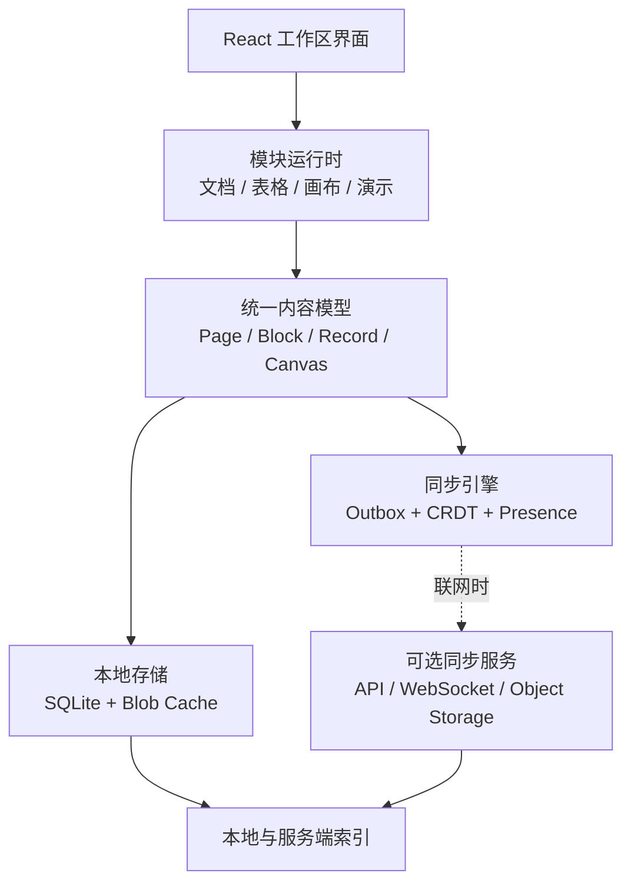

# 砚页 YanYe 技术架构

## 总体目标

架构需要同时满足本地优先、模块可插拔、实时协作和 Windows 桌面交付。核心原则是让所有内容都能被页面引用、被权限控制、被搜索索引，并且在离线时仍然可以编辑。

## 目标分层结构

0.1 已实现 Electron、React、Tiptap 和本地 JSON 工作区。图中的模块运行时、SQLite、同步服务和远端索引均为后续设计。



## Windows 客户端

当前客户端使用 Electron。

### 主进程

- 创建窗口并加载 `yanye://app/index.html`
- 管理本地工作区路径和文件对话框
- 处理导入、导出、外链和目录打开
- 配置上下文隔离、禁用 Node 集成、内容安全策略和导航限制
- 处理关窗保存和原子写入

### 渲染进程

- React 负责工作区布局、页面树和模块容器
- Tiptap 负责文档和 Markdown 编辑
- 现有编辑器挂载在页面树选中的文档上。后续计划通过统一的模块入口注册工具栏、内容渲染器和快捷键。
- 所有渲染模块通过 IPC 或同步 API 访问数据，不直接读写文件

### 预加载层

预加载脚本只暴露明确的命令接口，例如加载工作区、保存快照、导入文件、导出文件、打开目录和打开外链。新模块需要先增加白名单命令，再接入界面。

## 目标内容模型

### 页面

```ts
type Page = {
  id: string
  workspaceId: string
  parentId: string | null
  kind: 'document' | 'spreadsheet' | 'database' | 'canvas' | 'presentation'
  title: string
  icon?: string
  cover?: string
  favorite: boolean
  createdAt: string
  updatedAt: string
  deletedAt: string | null
}
```

### 文档块

```ts
type Block = {
  id: string
  pageId: string
  type: string
  position: number
  props: Record<string, unknown>
  text?: string
  children?: string[]
}
```

### 多维表格

```ts
type Database = {
  id: string
  pageId: string
  fields: Field[]
  records: RecordRow[]
  views: DatabaseView[]
}
```

### 画布

```ts
type Canvas = {
  id: string
  pageId: string
  objects: CanvasObject[]
  viewport: { x: number; y: number; zoom: number }
}
```

### 演示文稿

```ts
type Presentation = {
  id: string
  pageId: string
  themeId: string
  slides: Slide[]
  notes: Record<string, string>
}
```

页面元数据与模块内容分开保存。页面树更新只修改 `Page`。具体模块更新只修改自己的内容表和版本记录。

## 本地存储

### MVP

当前版本使用 JSON 工作区快照和原子替换写入，适合单用户和小型本地数据。

### 目标架构

- SQLite 保存页面元数据、块、记录、字段、画布对象和操作日志
- Blob Cache 保存图片、附件、缩略图和导出临时文件
- 每个实体拥有单调递增版本号
- 写入使用事务，附件使用内容寻址
- 回收站只是软删除，清理操作需要明确的用户动作

迁移旧工作区时先在临时数据库导入 JSON，保留页面 ID、父子关系、回收站状态和原始 Markdown，校验页数及各页正文后再切换。升级中断后仍可从原 JSON 打开。

推荐目录结构如下。

```text
%APPDATA%\YanYe\
├── workspace.db
├── blobs\
├── thumbnails\
├── exports\
└── logs\
```

## 实时同步

以下为协议设计。每项操作带唯一 ID，客户端在同一事务中保存内容变更和待发送记录。服务端完成权限检查和持久化后才确认，重复上传返回相同确认。界面分别标记“已保存到本机”和“已同步”。已撤权设备的待发送修改可另存本地副本。

### 同步对象

- 页面元数据
- 文档块
- 表格字段和记录
- 画布对象
- 演示文稿元素
- 评论和反应

### 操作流

```text
用户操作
  -> 生成操作记录
  -> 写入本地事务
  -> 写入 Outbox
  -> 本地界面立即应用
  -> 网络可用时上传
  -> 服务端广播远端操作
  -> 客户端按实体合并
  -> 标记已确认操作
```

### 冲突策略

- 文档块使用基于操作的 CRDT 或 Yjs 文档
- 表格单元格和记录字段使用字段级合并
- 画布对象使用对象级合并，位置冲突保留最近编辑并写入历史
- 页面标题、收藏和页面移动采用服务端版本校验
- 无法自动合并时显示差异，不静默覆盖用户内容

### 在线状态

Presence 只用于光标、选区、正在输入和当前页面等短生命周期信息，不写入内容历史。连接断开后客户端清理本地 Presence。

## 权限模型

权限按工作区、页面、数据库和分享链接分层。

| 角色 | 查看 | 评论 | 编辑 | 管理 |
|---|---:|---:|---:|---:|
| 只读 | ✓ |  |  |  |
| 评论者 | ✓ | ✓ |  |  |
| 编辑者 | ✓ | ✓ | ✓ |  |
| 管理员 | ✓ | ✓ | ✓ | ✓ |

数据库还需要字段级和视图级权限。附件下载、导出和外链分享都经过权限检查。服务端只返回当前用户可以看到的实体。

## 搜索架构

- 本地 SQLite FTS 索引页面标题、正文块、表格记录和评论
- 服务端使用同构索引，返回实体 ID、匹配片段和权限过滤后的结果
- 客户端先显示本地结果，再合并远端结果
- 搜索结果必须携带页面路径、模块类型和最近更新时间
- 附件内容索引放在后台队列，解析失败时保留附件名称搜索

## 模块插件协议

```ts
type YanYeModule = {
  id: string
  title: string
  icon: ComponentType
  create(): ModuleDocument
  render(document: ModuleDocument, context: ModuleContext): ReactNode
  commands: CommandDefinition[]
  exportFormats: string[]
}
```

首批内置模块为 `document`、`spreadsheet`、`database`、`canvas` 和 `presentation`。插件运行在受控沙箱中，不能直接调用 Electron 主进程。

## 导入导出目标

现版实现 UTF-8 Markdown 文件交换。下表是各模块的格式支持目标。Office 兼容性按样例验收，分别测试导入、编辑、导出和重新打开；发现不支持的对象时给出转换清单并保留原始文件。

| 模块 | 导入 | 导出 |
|---|---|---|
| 文档 | Markdown、HTML、DOCX | Markdown、HTML、DOCX、PDF |
| 电子表格 | CSV、XLSX | CSV、XLSX、PDF |
| 多维表格 | CSV、JSON | CSV、JSON、XLSX |
| 画布 | Mermaid、SVG、JSON | SVG、PNG、PDF、Mermaid |
| 演示文稿 | PPTX、图片 | PPTX、PDF、图片 |

导入过程生成可回滚的导入批次。导出过程在后台执行，失败时保留原始页面和临时文件。

## 安全边界

- 渲染进程不能访问 Node API
- IPC 命令使用固定通道和参数校验
- 自定义协议只允许加载应用资源
- 外链使用系统浏览器打开，禁止页面内任意导航
- 导入文件限制大小、扩展名和解析时间
- 当前识别出原始 HTML 的 Markdown 会在源码模式编辑。未来的 HTML 格式导入器需先清理内容再转换成可编辑节点。
- 分享链接使用短期令牌和可撤销权限
- 同步服务使用最小权限的对象存储凭证

## 测试策略

### 单元测试

- 页面树增删改移和回收站
- 块转换和 Markdown round-trip
- 表格公式和字段校验
- 画布对象序列化
- 权限判断
- 操作日志合并

### 集成测试

- 本地写入和崩溃恢复
- 导入导出
- 同步断线重连
- 两端并发编辑
- 大表格滚动和筛选
- 画布导出

### 桌面端测试

- Electron 窗口启动
- 键盘快捷键
- 文件对话框
- 关闭窗口保存
- 打包后的 Windows 便携版

## 开源仓库结构

```text
src/              React 渲染器与模块界面
electron/         Windows 外壳、IPC 和本地能力
shared/           共享数据模型与校验
modules/          后续文档、表格、画布、演示模块
server/           可选同步服务
packages/         共享协议、导入导出和测试工具
docs/             产品规格、架构和决策记录
test/             单元、集成和桌面端测试
```

仓库默认只包含本地客户端和共享模型。同步服务可以单独部署，避免用户被绑定到单一云服务。
