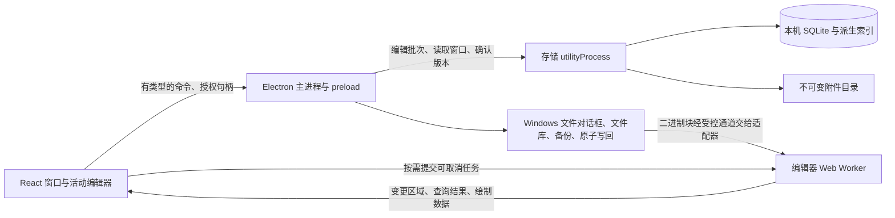

# 砚页 YanYe · Windows 本地端技术选型与架构

## 0.8 桌面运行时与扩展入口

Tauri 2 在 Windows WebView2 中加载随程序嵌入的 Vite 资源。React 管理编辑视图，TypeScript 描述桌面调用、菜单、围栏和功能区。已有的 JSX 编辑器由同一入口加载。Rust 在后台线程执行 SQLite 事务、修订重放、文件摘要计算和格式交换。Word 和演示稿的 PDF 输出使用 WebView2 打印引擎。[Tauri 命令模型](https://v2.tauri.app/develop/calling-rust/) · [WebView2 打印](https://learn.microsoft.com/en-us/microsoft-edge/webview2/how-to/print)

| 修改目标 | 扩展位置 | 需要保持的约定 |
| --- | --- | --- |
| 桌面能力 | [TypeScript 桥](../src/desktop/bridge.ts)、[Rust 入口](../src-tauri/src/main.rs) | 桥接在渲染 React 前就绪。渲染进程持有文件 ID，路径与原生对话框由宿主管理 |
| 保存与恢复 | [写入队列](../src/desktop/staged-writes.ts)、[工作区事务](../src-tauri/src/workspace.rs)、[磁盘文件](../src-tauri/src/files.rs) | 增量按修订顺序提交。失败时保留未确认队首。工作区修订和磁盘原件摘要分别校验 |
| 围栏语言或图形 | [语言与别名](../src/markdown-languages.ts)、[代码块](../src/MarkdownFence.tsx)、[源码映射](../src/markdown-projection.ts) | 引擎按需载入。阅读视图将改动写回原文。特殊图形保留可编辑的围栏文本 |
| Markdown 源码与引用 | [CodeMirror 视图](../src/MarkdownSource.jsx)、[语法着色](../src/markdown-source-language.ts)、[脚注与链接](../src/markdown-references.ts) | 大小文稿共用源码编辑器，行尾映射参与撤销。引用按定义解析，保存时优先使用未改动的原文片段 |
| DOCX 分节与文字修订 | [节属性](../src/modules/word-section-xml.js)、[修订事务](../src/modules/word-revisions.js)、[跨段修订](../src/modules/word-paragraph-revisions.js) | 对段内文字和段落末尾标记分别追踪，使拒绝修订能够重建原文段落 |
| Excel 透视与 XLSM | [透视表打包](../src/modules/sheet-pivot-xml.js)、[原件保留](../src/modules/preserved-workbook.js)、[VBA 读取](../src/modules/vba-reader.js) | 普通透视表写入原生缓存和关系。宏文件另走原包路径，读取模块源码与执行宏分离 |
| 透视表刷新与筛选 | [字段和汇总](../src/modules/sheet-pivot.js)、[刷新顺序](../src/modules/sheet-pivot-refresh.js)、[切片器 OOXML](../src/modules/sheet-slicer-xml.js) | 用实际字段值记录筛选选择，重算单个报告或按数据源依赖刷新整本，失败时保留上一个完整工作簿 |
| PPTX 对象动画 | [动画模型与时间线](../src/modules/slide-animations.js) | 常规效果使用对象标识映射。外来复杂时间线保留原 XML，无法安全重映射时阻止有损保存 |
| 编辑命令与功能区 | [Markdown 上下文菜单](../src/menus/MarkdownContextTools.tsx)、[Office 功能区](../src/office/Ribbon.tsx) | 菜单调用编辑器命令。命令可用条件、当前选区和撤销由所属编辑器管理 |

0.5 工作区与文件中心继续使用原目录。数据库升级与文件格式逻辑可以用独立临时目录验证，桌面验收还会启动真实 WebView2 窗口。以下章节记录此前各版本的架构和选型背景。

## 0.5.0 文件编辑路径

磁盘原件和工作区草稿共享文件绑定与修订摘要。DOCX、XLSX、PPTX 的常规编辑路径将支持的 Office 对象映射为可修改的本地内容。原版式替换路径按绑定重新读取原件，校验摘要，仅重写匹配的文字部件，再通过主进程排他创建副本。PDF 编辑保留页序、旋转和批注记录，生成副本时才应用到 PDF。Markdown 公式字体、图表渲染器和传统中文文本编码表均随应用提供，按需加载。[能力范围与原应用回读](LOCAL_OFFICE.md)

达到 256 KiB 的磁盘 Markdown 先将可见行交给 CodeMirror 6 绘制。输入、撤销和行尾映射与 TXT 复用同一套事务处理，按文件原始换行写回。大纲和字数在输入停顿后更新，切换至富文本时才解析全文。普通工作区文稿和小型磁盘文档沿用原有的编辑入口。

## 0.4.0 已接入桌面版的路径

- **保存。** React 对已接受的工作区修改分配修订和操作 ID。预加载接口只传本次改变的页面字段。电子文档正文使用 UTF-16 偏移量和局部替换，TXT 正文和混合行尾映射也可局部替换。主进程保留未确认批次，从第一个编辑开始安排 180 毫秒的写入窗口，连续输入仍能得到中间确认。
- **落盘与恢复。** 独立的 Electron utilityProcess 使用运行时的 `node:sqlite`，启用 WAL、外键和 `synchronous=FULL`。正文差异、字段、操作摘要和修订在同一事务内提交。主进程根据确认的修订回复窗口。辅助进程中断后可重启、重投同一批次。每 128 项正文修改压实对应文稿。
- **升级。** 首次启动在事务内导入旧 JSON，读回核对通过后公布库版本。迁移中断可重试。旧 JSON、文件中心索引和外部 Office 原件保留。磁盘文件仍使用独立的原件摘要与写回确认。工作区备份可以在应用正常退出后复制完整用户目录。
- **当前规模。** 启动时仍会装入工作区内容。电子文档和 TXT 已有文本差异存储，结构化 Office 内容更新按单页字段保存。FTS5 大库索引、附件独立存储和按可见区读取仍是下一阶段设计。此版沿用 24 MiB 工作区和 2,000 页上限。[存储进程](https://github.com/ZhaoZan010903/yanye-office/blob/9b14908e6a5fdbee76efbd9af0a41c862f01b0d7/electron/workspace-process.mjs) · [事务与迁移](https://github.com/ZhaoZan010903/yanye-office/blob/9b14908e6a5fdbee76efbd9af0a41c862f01b0d7/electron/workspace-database.mjs) · [离线恢复测试](../test/offline-desktop.mjs)

PDF 用本地 PDF.js Worker、字体、字符映射和解码资源；工作区只保存磁盘文件绑定。TXT 采用 CodeMirror 6，保留编码、BOM 和换行映射。Office 适配器把受支持的字形、段落和单元格属性写成原生 OOXML。下文的决策表保留 0.3.0 选型时的比较与后续门槛。

**决策摘要。** 以现有 Electron、React 和六类页面为起点，保留已验证的 Office 文件读写，优先解决整库传输、主线程解析和图片重复驻留内存的问题。下一代工作区选择后台 SQLite、按文稿分块的内容表和独立附件目录。文件编辑与工作区文稿共享部分编辑组件，各自保留独立的保存语义。服务端实现、部署和选型留到本地交付后。本文前半给出目标设计，后半记录 0.3.0 实现。[产品需求](PRODUCT_SPEC.md) · [性能验收](PERFORMANCE.md)

## 1. 两种内容与三个标识

| 产品入口 | 用户拥有的内容 | 存储与保存 | 转换及边界 |
| --- | --- | --- | --- |
| 本地文件 | 磁盘上的 DOCX、XLSX、PPTX、PDF、Markdown 或 TXT | 草稿在工作区；用户保存时写回选定文件，另存产生独立文件。在 Windows 资源管理器中可直接找到交付物 | 导入工作区生成独立文稿，记录源摘要和转换报告。后续编辑可分别进行 |
| 工作区文稿 | 电子文档、电子表格、演示稿、多维表格、流程图。产品构想中的「在线文档」从这里创建 | 断网即可在本机分配 ID、编辑、引用、自动保存、关闭再打开。提交成功显示「已保存到本机」 | 导出生成选定格式的文件。未来由用户主动发起共享，原工作区身份及内部引用继续有效 |

持久化使用三类标识。**文稿 ID** 识别内容和引用，移动、改名后保持。**文件绑定 ID** 由主进程生成，映射到本机路径与最近一次读取、写回的摘要。**对象 ID** 标识段落块、表格行列、记录、形状及连线端点。A1、页码、文件路径都是可变的展示坐标。0.3 部分对象已有 ID，例如多维表记录和画布节点；现有用坐标寻址的结构需要迁移。未来共享标识可作为文稿的可选绑定，原文稿的主键由本机保留。

## 2. 技术决策与取舍

| 决策 | 本地端选型 | 成本、备选与复审条件 |
| --- | --- | --- |
| Windows 桌面壳 | 延续 Electron + React + Vite，编辑器和格式库按需载入。沿用原生文件对话框、打印和便携打包 | Chromium 随应用分发，占用包体和进程内存。Tauri + WebView2 可复用前端，须重验目标机 WebView2 离线安装、打印、沙箱桥接与 Office 往返。WinUI 3 + Windows App SDK 可实现原生桌面交互，编辑器重写或嵌入 WebView 的代价需单独验证。若分块和虚拟化后仍无法达到启动与空闲内存门槛，再用相同功能集做 A/B |
| 文稿与文件编辑器 | DOCX / 工作区电子文档使用现有 Tiptap / ProseMirror。纸张、分页、分节属于排版层。Markdown 保留源码及现有富文本模式。TXT 与大文件源码候选 CodeMirror 6 | 深度排版需独立测试。TXT 先覆盖编码、换行和长行，使用 CodeMirror 前验证中文输入法、撤销、超长行换行和冷加载成本。共享文本内核时按格式注册命令 |
| 网格、画布、幻灯片 | Excel 与工作区网格复用公式和单元格组件；多维表用记录/字段模型。流程图沿用 SVG，增加空间索引、视口裁剪、折线布线；演示页复用场景模型用于编辑、投影与导出 | 大图先隔离文字测量、命中检测和拖动开销；仅当实测 SVG 对象数量成为瓶颈时，再评估 Canvas 2D 图元层，保留可访问的对象树和矢量输出。避免写两套公式引擎 |
| Office 文件交换 | 沿用 JSZip + 项目 DOCX 适配器、ExcelJS、PptxGenJS，逐项扩大样本覆盖。优先改善受支持部件的往返，复杂图表和分节列入保真测试 | 自有适配器便于接入原生文稿，维护 OOXML 兼容矩阵的成本长期存在。完整办公引擎可作为后续样本基准或替代方案，先量化安装体积、驻留内存、失真率与再分发条件 |
| PDF | 新增 PDF.js 作为解析/显示候选，先实现打开、缩放、分页、文本层与有文本页面的查找。Worker 与字体、CMap、WASM 资源全部随安装包提供。Word/PPT 现有导出继续用 Chromium 打印 | 阅读、批注和直接改写原 PDF 是不同交付项。初期批注锚定文件摘要、页码和页内坐标，可保存成独立数据；打印副本需验证字体与批注。签名、密码、扫描件 OCR、原文排版编辑须逐项立项 |
| 持久化与检索 | 目标为 SQLite WAL + FTS5 + 本机附件文件。首选打包运行时自带的 `node:sqlite`，专用后台进程运行同步查询 | 现有 JSON 整库快照易检查和移植，单次编辑会传送完整快照；IndexedDB 可做临时缓冲，用户工作区希望有独立备份、诊断和迁移工具。原生 SQLite 扩展是遇到驱动功能缺口时的备选，引入后必须验证 Electron 架构、ABI 与打包 |
| 开发语言与重计算 | 沿用 JS 运行时。在新建 IPC、操作和持久化边界使用可版本化类型定义与运行时校验；可先用 JSDoc，再逐模块引入 TypeScript。算法用分析器定位后才选择 Worker 或单个 Rust/WASM 内核 | TS 不能替代磁盘输入校验。WASM 允许复用算法，也引入初始化及内存复制成本；候选内核用同一数据集计入端到端时延 |
| 未来共享模型 | 先实现稳定对象 ID、可重放的本地命令和短暂的选区信息。富文本协作候选为 Yjs，可在隔离原型中接入 ProseMirror | 本地事务日志用于恢复和撤销，单调本地版本不足以处理多人并发。比较 Yjs 文本粒度与对象命令的语义成本。两份内存副本完成离线交错修改、收敛、体积与撤销试验后，再决定哪些工作区类型采用 CRDT |

框架和组件能力依据其维护方文档；表内选择是对本项目已有代码、迁移成本和目标的判断。[Electron 进程模型](https://www.electronjs.org/docs/latest/tutorial/process-model) · [Tauri 进程模型](https://v2.tauri.app/concept/process-model/) · [Microsoft WinUI 3](https://learn.microsoft.com/en-us/windows/apps/winui/winui3/) · [CodeMirror 视图](https://github.com/codemirror/view) · [Mozilla PDF.js](https://mozilla.github.io/pdf.js/) · [ECMA-376](https://ecma-international.org/publications-and-standards/standards/ecma-376/)

## 3. 本地进程和数据流

- **主进程**管理窗口、打开与保存权限、文件 ID、路径边界和外部变更冲突；IPC 沿用上下文隔离、固定命令与来源校验。磁盘路径通过用户操作授予。对传入文档禁用宏执行和隐式外链请求，解包读取约束条目数、解压体积、XML 深度和单图片尺寸。
- **渲染进程**只订阅活动文稿、可见块和相邻预取范围。文件中心先显示元数据，打开相应模块后再载入 Office 库。切走标签释放重型编辑器与渲染缓存，保留文稿 ID、选区、滚动位置和未提交命令。中文 IME 组合输入只在本地反映，组合结束后提交可撤销文本事务。
- **计算任务**按需使用 Web Worker 计算依赖关系、可见区域、索引文本及 PDF 页面。文件解码的重型工作移出渲染主线程，现有依赖 DOMParser、Image 或打印 DOM 的流程先拆成纯模型和最小视图步骤，再迁移。统一任务标识、输入版本、进度、取消和超时；迟到的结果按文稿版本丢弃。提交任务时安排并发上限，优先给当前视图和保存，避免同时解包多份大文档。
- **存储进程**在本机单独运行，通过消息处理事务、索引、历史与快照。大对象用分块或可转移的二进制缓冲传输；受平台支持限制的 IPC 路段通过主进程转发有界分块，禁止每次输入重新传全部附件。辅助进程退出后由主进程重启并查询最后提交序号，渲染器重发未确认批次。[Electron utilityProcess](https://www.electronjs.org/docs/latest/api/utility-process)

### 编辑与持久化时序

1. 输入先更新当前视图。本地操作含 `operationId`、`documentId`、`baseRevision`、动作版本和类型化载荷。撤销分组按用户动作定义，拖动只提交最终位置，粘贴一个区域按一个事务处理。
2. 存储进程单写队列检查基础版本、引用完整性和操作 ID。一次事务内写增量、更新当前版本、登记需重建的派生索引或缩略图；事务提交后才确认。重复 ID 返回原确认版本。旧版本上的互斥操作由调用方重读并重放可重放的命令，其余保留冲突草稿。
3. 「已保存到本机」对应存储提交。「已写回文件」另需格式转换成功及磁盘替换完成。保存过程中若有新输入，标记本次写回的版本并保留后续脏状态。崩溃只承诺恢复已确认的提交；未确认编辑的最大窗口由性能验收约束。关闭窗口等待写盘完成或让用户选择保留草稿。

## 4. SQLite、附件与恢复

**已做的运行时探针。** 用 0.3.0 Windows x64 打包程序创建临时用户目录，启动一个 `utilityProcess`，在该进程内用 `node:sqlite` 建立临时数据库。实际返回 Electron 45.5.0、Node 24.22.3、SQLite 3.54.1。`PRAGMA journal_mode=WAL` 返回 `wal`，FTS5 trigram 虚表创建成功，`backup` 为可调用接口。本次只验证运行时可用性，产品中的 SQLite 迁移、备份恢复和大库性能待实现与实测。发版 CI 应在打包产物上复验这些能力。[Node SQLite API](https://nodejs.org/api/sqlite.html) · [SQLite WAL](https://www.sqlite.org/wal.html)

| 持久化对象 | 关键字段与用途 |
| --- | --- |
| 文稿目录与引用 | `documents(id, kind, parentId, title, revision, deletedAt)`；另存结构化链接，按目标 ID 建反向索引。首次启动只取目录首屏 |
| 内容与视图 | 块文档按块存储和排序，网格存非空单元格与稀疏样式区，行列拥有稳定 ID；多维表拆字段、记录、视图定义；图形拆节点和边；演示拆幻灯片和对象。各适配器有独立 schema 版本，详情按需读取 |
| 文件绑定 | `bindings(fileId, documentId, path, sourceDigest, savedRevision, formatOptions)`；保留编码、换行和格式保真报告。重命名和移动仅修改绑定位置 |
| 可恢复编辑 | `operations(documentId, revision, operationId, version, payload)` 具有唯一键；保存定期快照和撤销检查点。经恢复测试后才压缩旧操作，保留历史版本所引用的附件 |
| 附件 | 数据库管理 MIME、大小、哈希与文稿/版本关系；磁盘按哈希存不可变文件。写入临时文件、校验并落盘，再在事务中建立引用。崩溃后回收未引用孤儿，回收前避开活动备份与历史保留期 |

**事务与备份。** 工作数据库放本机文件系统，使用单写者、外键约束、短事务，并先以 WAL + `synchronous=FULL` 测量提交时延；读任务分页并尽快结束事务。记录 WAL 增长、提交等待和 checkpoint 耗时，空闲窗口执行有界 checkpoint；长查询可取消。工作区整体导出在一致的数据库快照上生成清单，固定该快照引用的附件，逐文件验证哈希后发布。运行中使用 SQLite Backup API 或经验证的等价快照；单独复制使用中的主数据库会遗漏 WAL 内的提交。恢复先导入临时目录检查数据库完整性、外键、文件数和哈希，再切换活动目录。[SQLite WAL 与 checkpoint](https://www.sqlite.org/wal.html) · [SQLite Backup API](https://sqlite.org/backup.html)

**从 0.3.x 升级。** 在首开写入前记录源 schema、散列和目录清单，保留原始 JSON、文件索引、备份及外部文件绑定。使用旧版本校验器导入临时库，保持页面/记录/形状 ID，给尚无 ID 的行列与块补 ID 并保留旧坐标映射；提取内嵌图片，核对源/目标的对象数、内容摘要、引用、回收站、空内容和未写回草稿。校验通过后原子切换活动工作区指针。断电重启依阶段标记复用已校验的步骤，失败可直接回到未动的旧库。切换后产生的新编辑要随新版备份保留，旧客户端恢复旧快照时明确显示其恢复时间。

**中文检索。** 将文本投影按文稿块、记录或文本框切分，写入带来源 ID 和版本的索引。三字及以上子串采用 FTS5 trigram 候选检索并复核原文。本机探针中「工程项目记录」的「项目记」命中 1 条，「项目」命中 0 条。短词先查标题、字段名的单字/相邻双字倒排，正文 1～2 字可分批做规范化子串匹配；大库若无法达标，再实测短词正文倒排带来的体积与写放大。匹配投影使用 NFKC 及小写，候选用参数化 `instr` 字面核验。高亮需将投影范围映回原文，尤其注意规范化会改变字符数。查询返回原文锚点；删除、移动或重建时校验版本并过滤回收站。首屏可用后再继续建索引，正在重建时显示覆盖进度。[SQLite FTS5 trigram](https://www.sqlite.org/fts5.html#the_trigram_tokenizer)

开发机还用 5 个标题验证了短词回退。「项」「项目」「ab」「_%」经上述标题索引分别命中 4、3、1、1 条，覆盖倒序词、全角英文与字面通配符。该小样本只验证检索语义；正文大库延迟、索引占用与写放大遵循单独的性能验收。

## 5. 文件适配器和格式保真

统一适配器负责探测格式与能力、读取到可编辑模型、生成兼容报告和序列化。读取结果记录原件摘要、文件选项及不支持的部件。默认只读打开不触发写回。DOCX、XLSX、PPTX 新增高保真路径时，保留未修改的包部件、关系、内容类型与条目名；涉及编辑部件共享的编号或引用必须重映射并验证。无法保证一致性的部件列入报告，走另存副本或用户确认的有备份写回，不能标成无损。文件写回仍由主进程完成，再次核对摘要、写同目录临时文件、替换、更新文件绑定；替换失败时保留草稿和上次原件。磁盘替换与数据库确认跨两个介质，需用写回意图记录目标摘要；重启时通过摘要识别已替换、尚未替换或外部冲突三种情况。

| 格式 | 本地实现落点与验收样本 |
| --- | --- |
| DOCX、XLSX、PPTX | 复用现有适配器；文字、图片、表格、公式、合并、幻灯片文本框与演讲者备注分别做“外部应用 → 砚页 → 外部应用”往返。对复杂域、外链数据、宏、字体替换、动画和嵌入对象登记保留或简化结果。Office COM 仅用于有 Office 的互操作测试机 |
| Markdown、TXT | Markdown 保留源码模式及未触碰的语法。TXT 计划记录编码、BOM、混合换行和末尾换行；用 BOM 或严格 UTF-8 识别，其他输入允许用户预览后明确选择 GB18030 / UTF-16 等编码。保存回原编码前检测不可表示字符，提供另存 UTF-8。黄金样本比对未编辑文件的字节和编辑后未触碰区间 |
| PDF | 查看以原文件为主，按视口渲染邻近页。批注位置按文件摘要、页、未缩放页面坐标和旋转映射；扫描页无文字层时如实提示查找范围。对照带签名原件、批注副本和重写副本分别检查签名状态。使用可重建的页面缩略缓存 |

读取阶段识别 PDF / Office 包中的签名、证书关联和受保护内容，向用户说明支持范围。原件保持字节级不变时才可按原件交付；涉及受签名内容的编辑、重排及重新打包可能使签名失效，即使页面外观没有变化也应提示并优先另存。带签名样本要在原应用或独立验证器检查有效状态。缺少验证实现时显示“签名状态未验证”，不得根据签名图章、复制的证书或原件备份推断修改后签名仍有效。

## 6. 工作区文稿与未来光标

本地创建只需要文稿和本机设备的 ID，断网时编辑、撤销、搜索、备份、导出均在上述本机路径完成。给共享留两个可替换边界：内容适配器交付持久变更，状态适配器交付临时光标/选区。本期只接本机存储。多人原型需要时可在同进程模拟多份内存副本，通过固定种子重放交错修改来验证模型。

| 类型 | 稳定锚点与未来的多人语义 |
| --- | --- |
| 电子文档 | 块 ID + 文本相对位置；段落拆分、合并后重定位选区，锚点删除则隐藏或降级到仍存在的祖先块 |
| 电子表格、多维表格 | 表/视图 ID + 行列或记录/字段 ID；插入行后计算新的屏幕位置。筛选掉记录时不把光标显示到错误行。公式重算值为派生结果 |
| 演示稿、流程图 | 页/画布 ID + 对象 ID，在对象内使用局部坐标；空白画布使用未缩放的世界坐标。连线引用端点 ID，复测删除端点与移动对象的交错操作 |

未来接入时，presence 携带参与者会话、文稿/视图、选区和最后活动时间，限频更新，超时清理；文稿历史和备份只存内容操作。未来从本地发起共享可给既有文稿追加绑定，在服务器上新建时也能挂接同一类本地副本；当前客户端不会据此产生已共享标识或远端参与者。服务器创建、身份授权、多人传输和上线验证由最后的团队文档里程碑负责。[Yjs Awareness](https://docs.yjs.dev/getting-started/adding-awareness) · [Yjs 相对位置](https://docs.yjs.dev/api/relative-positions)

## 7. 实施门槛

| 工程交付 | 可判定的进入下一阶段条件 |
| --- | --- |
| 建立基线 | 按性能规范记录冷启动、输入、打开、计算、切页、保存、搜索的分位数、峰值内存和数据规模；分别采样 UI、解码、IPC、索引及磁盘，以打包程序测量 |
| 持久化垂直切片 | 先贯通一类工作区文稿的断网创建、编辑、按增量提交、退出恢复、可读备份及旧库迁移。对事务提交前后、发布指针前后、磁盘写满和锁占用做故障注入，已确认内容逐项一致 |
| 普及内容模块 | 各类型按性能合同通过实际大样本；保留 0.3 Office / 文件中心回归；TXT 编码和 PDF 查看单独验收；五类工作区文稿复测跨文稿引用、回收站和导出 |
| 打包与升级 | 在无网、无 Office 的干净 Windows x64 机器安装或解压后完整使用；另在装有 Office 的机器跑格式互操作。打包本文所选运行时、阅读器资源和许可证；记录每个锁定版本的来源、许可证、NOTICE、字体嵌入与资源再分发条件。PDF.js 为 Apache-2.0；自带 CMap / 字体另核各自许可。[PDF.js 项目说明](https://mozilla.github.io/pdf.js/) |
| 最后评估共享 | 富文本、记录和画布两副本离线编辑后收敛，编辑历史与光标生命周期独立，现有本地文件保存语义稳定。达到这些条件后再开启团队协作开发 |

开源分发以实际锁定版本附带的许可证文件为准。0.3.0 本机包元数据显示 Electron、React、Tiptap core、ExcelJS、PptxGenJS 为 MIT，JSZip 提供 MIT 或 GPL-3.0-or-later 双许可，项目采用其 MIT 路径。发布继续附 Electron/Chromium 的第三方声明、Vite 生成的依赖许可清单，并逐项核新增资源。SQLite 上游以公有领域分发。[构建配置](../vite.config.mjs) · [SQLite 版权说明](https://sqlite.org/copyright.html)

性能优化与准入的具体数值、测试环境和采样方法统一维护在[性能验收](PERFORMANCE.md)。以下内容用于核对起点，0.3.0 尚未采用上述存储架构。

## 0.3 的运行结构

砚页运行在 Windows x64 的 Electron 窗口中。React 渲染页面树和各编辑器，Vite 构建本地界面。文件读写与系统对话框由主进程负责，渲染进程通过启用上下文隔离的预加载接口访问它们。

| 位置 | 职责 |
| --- | --- |
| `electron/main.mjs`、`electron/preload.cjs` | 窗口生命周期、文件选择、格式与大小检查、PDF 打印、受限的 IPC 接口 |
| `electron/store.mjs` | 读取、校验、排队写入本地工作区快照 |
| `electron/library.mjs`、`src/FileCenter.jsx` | 选择和浏览本地目录、文件操作、最近文件索引、摘要校验与原件备份 |
| `src/office-files.js`、`src/use-disk-files.js` | 根据实际扩展名选择转换器，将文件绑定到单独的编辑页面，处理打开、写回和另存 |
| `shared/workspace.mjs` | 页面类型、工作区版本、树结构、回收站、容量及数据完整性检查 |
| `src/App.jsx`、`src/workspace-ui.jsx` | 页面切换、编辑分派、搜索、保存状态及工作区交互 |
| `src/editor.jsx` | Tiptap 富文本编辑、Markdown 源码、大纲、文档工具栏 |
| `src/modules/` | 电子表格、多维表格、白板和演示的 React 编辑界面、内容模型、文件交换 |

## 工作区数据与兼容

工作区根对象含 `schemaVersion`、`revision`、`activeId`、`collapsedIds` 和 `pages`。页面公共属性包括稳定 ID、父页面 ID、类型、标题、收藏标记及时间戳。移入回收站记录删除时间，恢复页面时沿用原 ID。搜索读取页面标题、Markdown 和办公内容中的可检索文本。

| 页面类型 | 持久化内容 |
| --- | --- |
| Markdown 与早期内建页面 | `page.markdown` 是 Markdown 原文 |
| `word` | Tiptap 文档树、纸张和边距、导入兼容提示；字符属性、列表、表格、插图与分页符随文档保存 |
| `spreadsheet` | 工作表列表及活动表，单元格地址映射到原始输入，另存格式和表内设置 |
| `database` | 字段定义、记录及字段值、当前视图、分组字段和日期字段 |
| `canvas` | 节点、按节点 ID 连接的边、自由笔迹和视口 |
| `presentation` | 主题和有序幻灯片数组，逐页保存版式、标题、正文、第二栏、备注及可选的内嵌图片 |

各办公页面在 `page.content` 内维护内容模型，空对象由对应编辑器解释为初始内容。工作区可以读取 schema 1、2、3。使用 Word 或绑定磁盘文件时才升级为 3。绑定信息 `page.disk` 包含主进程分配的文件 ID、显示名、扩展名、读取时的内容摘要及待写入标志；旧版页面可继续编辑。

## 保存与恢复

1. 用户修改页面时，渲染进程更新工作区快照与修订号，并通过预加载接口交给主进程。主进程只接收更新的修订。
2. 存储层串行写入，在目标目录创建临时文件并替换 `workspace.json`。一次写入进行时如有更新，后续写入继续保存较新的快照。
3. 手动保存等待写入结束。关闭窗口时，主进程请求渲染进程交出最终快照并等待落盘。读取已有文件遇到解析或结构错误时报告错误。首次运行且文件不存在时建立初始工作区。

默认位置为 `%APPDATA%\YanYe\workspace.json`，`YANYE_PROFILE` 可指定独立目录。工作区最多 2,000 页，单页 Markdown 最多 2,000,000 个字符，整个工作区序列化后最多 24 MiB。内嵌图像同样计入总量。关闭应用后复制工作区文件即可做整库备份。

文件中心有独立的本机文件索引。主进程根据 ID 解析打开过的绝对路径，目录操作在用户所选根目录中进行。保存已有文件时校验磁盘摘要，在 `file-backups/<id>.bak` 写入上一份内容，再替换目标。另存后页面绑定到新文件。关闭标签或窗口时，有修改的磁盘文件可保留本机草稿。复制整个用户目录可以同时保留工作区、文件索引和备份；磁盘上的源文件保存在各自目录内。

## 各编辑器如何工作

### DOCX 与文字处理

Word 编辑器用 Tiptap 表达段落、字符格式、内嵌图片、表格和手动分页。DOCX 适配器用 JSZip 读取与写出 OOXML 文档、样式、编号、关系和图片部件。支持的纸型与边距同步到导出用的打印视图。外部文件中的复杂部件按模块支持范围转换。[Word 编辑器](../src/modules/Word.jsx) · [DOCX 写出](../src/modules/word-docx.js) · [DOCX 读取](../src/modules/word-import.js)

### Markdown

编辑器在 Tiptap 文档与 Markdown 间转换，源码模式直接修改原文。遇到富文本转换无法可靠往返的语法时优先使用源码。大纲和任务统计从当前内容提取。[文档编辑界面](../src/editor.jsx)

### 电子表格

工作表按 A1 地址稀疏存储。公式解析器识别基础运算、绝对与相对引用、跨表引用、区间和内置函数，在读取显示值时求值。公式错误以单元格错误值呈现。插入或删除行列、重命名工作表会处理对应引用。排序筛选影响显示顺序，柱状图从选定列的数值和首列标签取数。[工作表模型](../src/modules/spreadsheet.js)

XLSX 适配器使用 ExcelJS，将单元格输入、公式和部分常用数字格式映射到工作簿。导出保留支持的原生公式，CSV 导出使用计算后的值。编辑器柱状图属于砚页的表内设置，XLSX 写出逻辑处理单元格值与格式。[XLSX 适配器](../src/modules/spreadsheet-xlsx.js)

### 多维表格

字段与记录都使用稳定 ID，每条记录以字段 ID 为键保存值。同表关联保存目标记录 ID，公式字段从指定的两个数值字段计算。表格、按单选值分组的看板、按日期字段排布的日历共用记录集合，更新卡片会写回对应字段。[多维表格模型](../src/modules/database.js)

JSON 备份保存完整模型，导入时校验字段与记录。CSV 和 XLSX 输出显示值，适合交给外部工具处理。导入二维文件时按表头重新建字段，XLSX 取第一张工作表。[多维表格编辑器与文件交换](../src/modules/Database.jsx)

### 流程图与白板

SVG 编辑区按节点、连接线和笔迹渲染。边保存端点节点 ID 和文字，绘制时根据节点位置计算端点。平移缩放使用独立视口，编辑操作支持撤销和重做。JSON 备份可恢复模型。完整场景可导出 SVG、PNG，流程关系可转换为 Mermaid。[画布模型](../src/modules/canvas-model.js) · [白板编辑器](../src/modules/Canvas.jsx)

### 演示文稿

编辑、放映和导出使用相同的版式定义。文档大纲转换读取当时的 Markdown，创建独立幻灯片。PptxGenJS 将文字、图片与备注写入 PPTX。导入使用 JSZip 读取 Office Open XML 部件，并将支持的文字、备注和配图映射到砚页版式。[版式与文档转换](../src/modules/slides-model.js) · [PPTX 适配器](../src/modules/slides-pptx.js)

PDF 导出时，渲染进程建立完整的 16∶9 打印页，等待字体与图片就绪，再由 Electron 调用 `webContents.printToPDF` 输出。打印样式按页分页，并隐藏桌面控件与讲者备注。[演示文稿界面](../src/modules/Slides.jsx) · [桌面主进程](https://github.com/ZhaoZan010903/yanye-office/blob/9b14908e6a5fdbee76efbd9af0a41c862f01b0d7/electron/main.mjs)

## 验证与发布

- `pnpm test` 运行 Node 测试，涵盖工作区和模块模型及受支持的格式交换。
- `pnpm test:desktop` 构建渲染资源，在 Electron 中验证桌面操作、持久化与文件交互。
- `pnpm package:win` 构建 Windows x64 便携目录。分发时需要保留 `YanYe.exe` 和同目录的运行时与资源。

## 演进顺序

从 0.3.0 起先冻结基线，再以一类工作区文稿贯通后台增量存储、附件、迁移、备份和恢复。通过故障注入与代表性样本验收后，将同一存储与任务接口推广到其余类型，并增量交付 TXT、PDF、排版与文件兼容能力。各批次沿用文件中心和原生 Office 往返回归，用性能规范核对输入、打开、恢复和大库搜索。

最后开发团队文档协作。待所有本地里程碑完成后，再设计身份与权限、共享文档、多人编辑协议、重连及冲突处理。[产品路线与验收条件](PRODUCT_SPEC.md)
