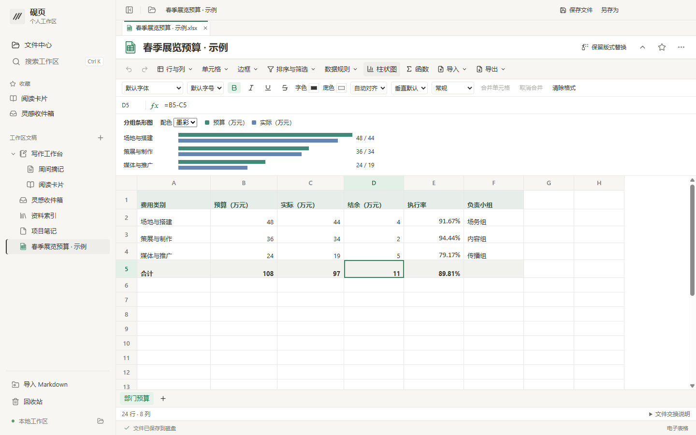

# 砚页 0.5 · 本地办公兼容说明

同一份文件有两种编辑入口。日常写作、计算和排版从文件中心打开，在对应编辑器内工作。合同、预算模板或汇报材料若只涉及名称、日期等文字变更，可从文件行的「… → 保留版式替换」进入。第二个入口直接读取磁盘版本，即使常规编辑器无法还原某个对象，也可以预览匹配并生成独立副本。

## 本地工作区验收范围

| 格式 | 可以在砚页完成的工作 | 兼容边界 |
| --- | --- | --- |
| Word · DOCX | 中西文字体、中文字号、颜色、上下标、段落间距、表格、插图、纸张方向和页边距。分别编辑默认页、首页、偶数页的页眉页脚，插入当前页和总页数域，导出分页 PDF。在正文段内选中文字新增署名批注，定位或删除后写回 Word | 编辑器采用连续纸面。多节独立排版、页眉中的表格及图形、跨段批注及讨论串、修订和邮件合并仍需原应用复核 |
| Excel · XLSX | 选区和单元格样式、冻结、跨表计算，条件计数与求和、精确及近似查找；下拉验证、数值条件格式和按值筛选；按区域建立带图例和配色的多系列条形图，在 Excel/WPS 中继续改图 | 每表支持一张此类图表，来源为本表区域，上限 6 个系列、500 个分类。复杂图表、数据透视表、VBA 和外部数据连接尚未纳入编辑模型 |
| 演示 · PPTX | 提纲生成幻灯片、备注和放映。插入六种形状，设置填充、轮廓、位置、大小、旋转和形状层次；文本框支持字体、粗体、斜体、对齐。每页可设切入或淡化、单击和定时换页 | 自由文本框与六种形状可写回原生对象。母版设计器、对象动画时间轴、组合及音视频编排仍需原应用；常规导入每页读取第一张支持的 PNG/JPEG |
| PDF | 阅读和查找带文字层的页面，选择文字做彩色高亮，放置中文便签，旋转、调序、移除页。按页码范围提取，追加另一份本地 PDF，将结果写到新文件 | 标准便签和高亮写入 PDF。扫描页可阅读，OCR、正文重排编辑、签章及交互表单编辑尚待实现。对签名文件的编辑副本应单独验证签名 |
| Markdown · MD | 富文本和源码写作、分级标题、大纲、查找替换、专注和打字机模式。阅读视图在正文原位排版行内与块公式、渲染 Mermaid 图，单击图或公式可回到对应源码 | 复杂 Markdown 扩展可在源码模式保留；公式排版遵循打包的 KaTeX 语法，Mermaid 预览使用受限的本机配置 |
| 纯文本 · TXT | 查找替换、行列定位、书签跳转、复制与移动行、排序去重、自动折行、显示空白。可选 UTF-8、UTF-16、GBK、GB18030 并核对编码后写入，换行及 BOM 可撤销 | 旧编码无法表示的字符会标明码位，可另存 UTF-8 副本。Notepad++ 插件、宏录制与多语言代码 IDE 能力仍在后续范围 |



## 如何保留复杂模板

1. 在文件中心打开 DOCX、XLSX 或 PPTX，点编辑器标题旁的「保留版式替换」。也可以直接从文件列表操作。输入区使用精确、区分大小写的文字匹配。
2. 预览会列出命中数量及前八组上下文。Word 搜索普通段落、页眉、页脚、脚注和尾注；演示文稿搜索幻灯片及备注；电子表格搜索共享及内联字符串。共享字符串的一处匹配可能影响多个单元格。
3. 输入替换内容并保存到一个新文件名。跨不同字体或粗细的文字仍能整体匹配，替换文字沿用首个匹配字符的样式。未改动的 XML、媒体、嵌入对象及关系部件保留原有解包字节。ZIP 的整体压缩字节可以变化。
4. 使用「返回文件中心」打开副本。与工作簿内容相关的公式缓存，可在原应用重算后复核。数字签名文件会停止替换。源文件在打开后被其他程序修改，也会要求重新读取。一般编辑器保存外部 Office 文件前保留上一版原件。

## REA 与第三方回读

开发使用了本机程序的版本、公开命令和原应用自建样本。REA 的文件摘要和 Office 包目录用于识别样本，再检查样本中的公开 OOXML、PDF 对象及其关系，独立实现编辑命令。仓库中的交互和测试夹具均可从源码重建。

| 观察对象 | REA 记录前缀与可复核的行为 |
| --- | --- |
| WPS 文字、Microsoft Word | WPS DOCX `ev_014f4eef4a5d`、Word DOCX `ev_a48e63303d35`。页眉与页脚由节属性引用，PAGE 的指令、显示值及结束标记可拆成多个文字运行。批注样本 `ev_37203c272853`、`ev_7fc94b0f2712` 用于核对正文锚点与批注部件 |
| WPS 表格、Microsoft Excel | XLSX `ev_14757b3b0dbb`、`ev_372543382771`，图表样本 `ev_31d5310b29f8`、`ev_9dee99fb98bf`。读取验证规则、条件格式、筛选条件和图表系列的原生区域引用 |
| WPS 演示、Microsoft PowerPoint | WPS 12.1.0.29690、PowerPoint 16.0.20625.20108。本机 PowerPoint 的淡化、三秒换页样本 `ev_bb5ba1fb5efe`，其中包含 `p:fade`、`spd` 和 `advTm`。回读测试将其改为切入、半秒换页，并检查几何对象和字体 |
| WPS PDF | 12.1.0.29690。核对了本机入口文件及 PDF 模块元数据。编辑后的两页副本在 WPS PDF 普通窗口、PDF.js 及 Poppler 中核对。WPS 显示原第 2 页旋转 90° 后排在首页，高亮覆盖对应文字，双击便签读回作者「砚页」和正文「第二页核对」 |
| Typora、Notepad++ | Typora 1.14.15 `ev_3a2cfe423832`、Notepad++ 8.9.9.1 `ev_10f9ca4331b1`。核对标题、写作模式、查找、书签及复制行命令。[Typora 官方快捷键](https://support.typora.io/Shortcut-Keys/) · [Notepad++ 取样版本](https://github.com/notepad-plus-plus/notepad-plus-plus/releases/tag/v8.9.9.1) |

工具条分组和有色图形参考 [GenOffice](https://github.com/genspark-ai/genoffice/tree/a6ff5ffd95cd8502ef3d9ddc2523b65e06253fe4)。六种文件标识采用原创折页图形与不同内部笔画，应用外壳沿用米纸、墨色和 1px 细分隔。悬停在 150ms 内改变颜色，Windows 的减少动态效果设置也作用于放映淡化。作者可为图表选择配色，系列同时使用图例标识。

## 判定能否替代原应用

每项验收从原应用新建样本开始，经砚页断网修改、保存、关闭、重开，再让原应用读取可编辑对象、核对值和打印布局。下面记录涉及全量替代目标的主要待验任务。

| 工作区 | 待验工作样本 | 通过条件 |
| --- | --- | --- |
| 文字 | 含纵横向混排、多节分栏、浮动图表、目录、脚注和多人修订的长报告 | 分节设置、页码、脚注引用与修订作者可读，接受或拒绝后内容和打印分页与样本相符 |
| 表格 | 含数据透视表、动态数组、图表组合和外部数据源的财务分析工作簿 | 编辑数据后可刷新透视结果、传播溢出区域，保留图表引用和连接配置；在 Excel 与 WPS 中重算结果一致 |
| 演示 | 使用自定义母版、组合图形、音视频、逐对象动画顺序的讲稿 | 各页继承原母版，动画顺序、触发条件和媒体位置可编辑，原应用放映时逐项核对 |
| PDF | 含扫描页、表单字段和数字签名的归档材料 | 记录 OCR 校核结果，验证字段值和外观，显示签名覆盖范围及修改状态；原件与导出件可分别核验 |
| Markdown | 含脚注、交叉引用、复杂表格、数学环境及自定义主题的出版文稿 | 对照 Typora 核验排版，源码修改精确定位，保存重开后符号、空格与换行可逐段核对 |
| TXT | 大日志的列选区、跨文件正则替换、宏录制和多语言语法高亮 | 对照 Notepad++ 核验命中位置、原编码字节、撤销范围及大文件交互延迟 |

旧二进制 DOC、XLS、PPT 和加密文件的直接编辑亦需单独验收。编辑和转换都沿用独立样本及可恢复原件的验收方式。

## 发布包验收

Windows x64 便携版产品版本为 0.5.0。打包后的 `app.asar` SHA-256 为 `1058263f497f2b373c24b7339d8310bd8ad73521a25cc6698900a5cf927d7d2e`。三份格式替换副本分别由 Microsoft Word/Excel/PowerPoint 和 WPS 文字/表格/演示打开，确认正文与域、单元格值与公式、演示文本框。另用 Word/WPS 核对段内批注的作者、范围和内容，Excel/WPS 核对图表引用、条件和重算值，PowerPoint/WPS 核对可编辑的形状、颜色和切换效果。Markdown、TXT、迁移和强杀恢复均使用同一便携版及隔离的本机目录验证。

## 复验

本次本机交付的 `YanYe-0.5.0-win32-x64.zip` 为 164,413,862 字节。归档内 73 份文件已与测试目录逐一核对 SHA-256。整个 ZIP 的 SHA-256 为 `e2322e997120d98c371527b57287f26ed509c9686fc916ee122e1ecb33fa614a`。重新构建时归档时间戳可能不同。

在仓库根目录运行 `pnpm test`、`pnpm package:win`，然后执行下列命令。桌面脚本使用隔离工作区和生成的本地样本。原应用回读脚本需要在已安装相应办公套件的 Windows 上执行。

```powershell
$exe = '.\release\YanYe-win32-x64\YanYe.exe'
node test/original-desktop.mjs $exe
.\test\original-native.ps1 -Executable $exe
node test/writing-tools-desktop.mjs $exe
node test/word-desktop.mjs $exe
node test/spreadsheet-desktop.mjs $exe
.\test\workbook-native-rules.ps1
.\test\presentation-native.ps1 -Executable $exe
node test/presentation-markdown-performance.mjs $exe 30 presentation-markdown.json
```

原版式替换测试逐一比较 DOCX、XLSX 和 PPTX 的所有 ZIP 成员，核对只有目标文字部件发生变化，同时检查磁盘原件、未支持的附加部件、公式和域显示值。性能的样本规模、计时口径和构建摘要见[性能记录](PERFORMANCE.md)。
