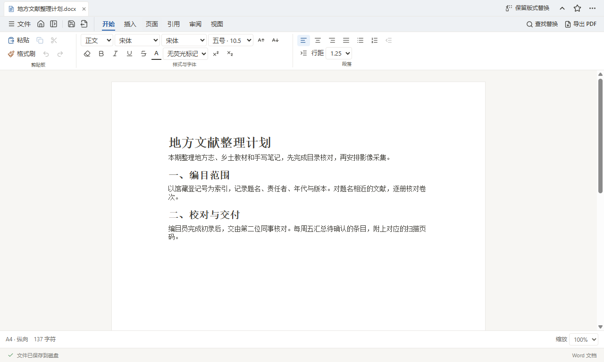
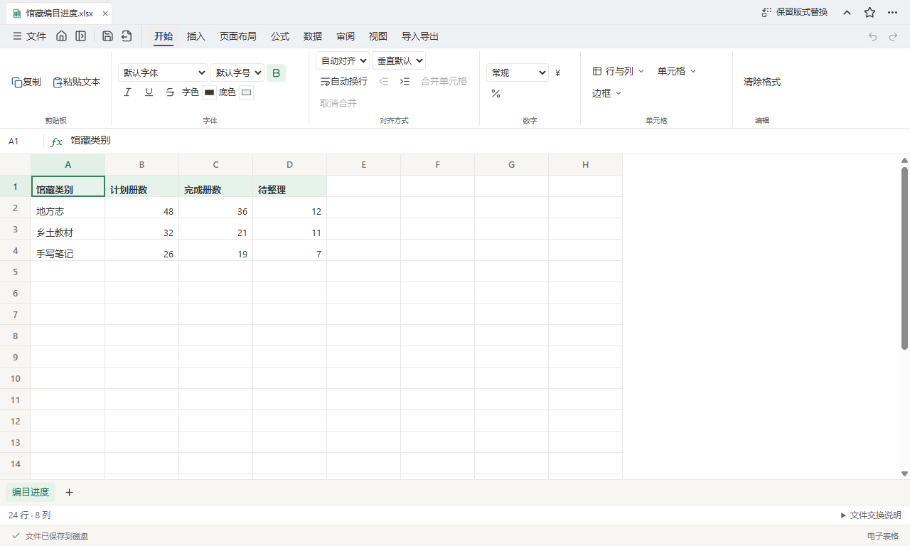
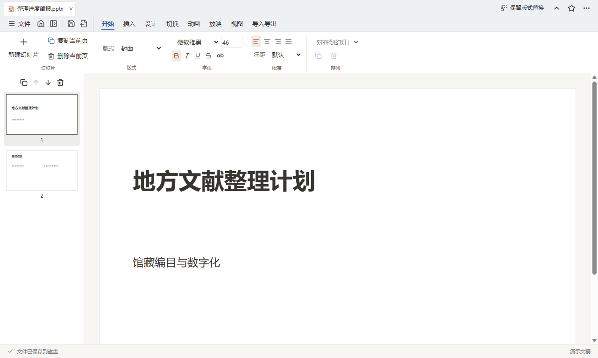

# Windows 本地办公工作区

砚页 0.9 的文字、表格和演示共用文件栏。顶部保留打开的文件标签与未写入磁盘的圆点。下一行放文件菜单、快速保存和各编辑器的选项卡，下面是当前选项卡的命令。打开本地 Office 文件时，侧栏默认收起；用文件菜单旁的侧栏按钮可以展开，应用会记住选择。

按 `Ctrl+S` 保存，`Ctrl+Shift+S` 另存，`Ctrl+F1` 折叠或展开工具。折叠后仍可点选项卡。用 `F10` 将焦点移到当前选项卡，左右方向键切换，`Home`、`End` 跳至两端，`Esc` 返回原控件。

## 对照 WPS 文字的六张截图

下表按实际操作列出范围。部分入口合并在同一组，例如页码在「页眉页脚」内。每个选项卡的菜单深度、可选参数与 WPS 仍有差异。

| 选项卡 | 可以在砚页完成的工作 | 仍有差距的工作 |
| --- | --- | --- |
| 开始 | 粘贴文本、剪切、复制、字符格式刷、段落样式、中西文字体与中文字号、增减字号、清除字符格式、粗斜体、下划线、删除线、上下标、字色和高亮、列表、缩进、对齐、行距、查找与替换 | 跨应用保留全部粘贴格式、复杂多级编号、自定义样式集和公文排版 |
| 插入 | 空白页、分页符、页眉页脚与页码域、可编辑表格及行列、嵌入 PNG/JPEG、超链接、命名书签、常用符号和批注 | 公式对象、艺术字、任意浮动形状和文本框、截屏、封面库及文档部件库 |
| 页面 | 按节设置上下左右页边距、纸张方向、纸型、分栏、节起始位置和行号。可设整份文档的底色，以及本节的单线、双线、虚线或点线边框 | 图片或纹理页面背景、艺术型边框、水印、稿纸与整套模板 |
| 引用 | 按标题级别插入与更新目录，新增、编辑、定位脚注和尾注，插入书签文字交叉引用。WPS、Word 可以更新导出的目录域 | 图表题注与图表目录、索引标记与索引、邮件合并 |
| 审阅 | 记录增删及跨段修订，切换原始/最终/带标记视图，上一处/下一处、逐条或全部接受与拒绝，定位和删除署名批注 | 两文件比较与合并、按作者筛选全部标记、限制编辑、手写笔迹 |
| 视图 | 页面、阅读、Web、大纲、全屏和写作模式；大纲按级别筛选、提升/降低标题；导航窗格、标尺、网格线、段落标记、缩放、页宽和护眼模式 | 并排比较与同步滚动、多窗口重排、完整打印分页视图 |

新建 DOCX 使用 A4、宋体五号，上下页边距 2.54 厘米，左右 3.18 厘米。已有文件使用读入的正文默认字体、字号与页边距。护眼和写作模式只影响当前编辑界面。导入的不等宽分栏在编辑器中以等宽预览。脚注、尾注和行号的逐页位置取决于分页引擎。砚页可显示当前节的实际折行行号，按页重编原样保留到 DOCX，本地 PDF 导出暂不绘制行号。

正文中的普通日期、页码和总页数域在砚页显示上次保存的值。用户可以编辑旁边的正文，原应用仍可读取域指令、结果和锁定状态。带绘图或复杂嵌套的域会触发原版式保护。[普通域的原生核验](../test/word-common-fields.ps1)

## 电子表格

选项卡为「开始、插入、页面布局、公式、数据、审阅、视图、导入导出」。在「页面布局」设置纸型、方向、边距、打印区域、重复标题行和列，以及打印网格线、行号列标和水平居中。在「审阅」里新建、编辑、定位和删除单元格批注。开始页提供字体、对齐、换行、缩进、数字格式和合并单元格。公式页可从选区插入常用汇总公式。已有的多级数据透视表、列字段、切片器及刷新操作保留在「数据」。

页面设置写入 XLSX，可在 Excel 和 WPS 表格中预览并打印。砚页的常规表格编辑器每张工作表支持最多 5,000 行、128 列。批注使用传统单元格批注，暂未提供工作表打印预览、线程评论或 VBA 编辑执行环境。

## 演示

选项卡为「开始、插入、设计、切换、动画、放映、视图、导入导出」。选中标题、正文、右栏、文本框或形状文字后，开始页控制目标对象的中英文字体显示、字号、字色、粗斜体、下划线、删除线、对齐和行距。可以让对象与整张幻灯片的边缘或中心对齐，复制、删除或调整位置。在视图页切换普通视图和幻灯片浏览，显示缩略图、备注和网格，调整缩放。动画窗格可编排逐段播放和自定义运动路径。

目前字体与段落设置作用于整个文本对象。同一文本框内逐字混排、母版编辑、复杂组合和完整媒体时间线仍有差距。

## 本轮验收

| 校样 | 核对方法 |
| --- | --- |
| 三种 Windows 工作区 | 在独立 WebView2 配置目录逐个打开测试文件。检查文件菜单的位置、键盘切换、收折和 760 像素窗口。DOCX 另检大纲升降级、写作与全屏、页面边框和底色，重启后从磁盘核对。传入 `--native` 时，WPS 文字与 Microsoft Word 还会在同一路径各保存一次，再由砚页读回。[桌面验收](../test/office-ribbon-desktop.mjs) |
| DOCX 目录、书签与注释 | 在编辑器插入目录、脚注、尾注和跨段书签，设置 3.18 厘米左页边距。在 WPS、Word 中分别更新目录和书签引用域、追加脚注文字，每次保存后回到砚页核对。[原生往返验收](../test/word-reference-native.ps1) |
| DOCX 正文默认格式与行号 | 分别加载新建模板、已有默认样式与旧工作区校样。两节行号校样由 WPS、Word 在同一路径依次修改间隔，另检折行、缩放和移除单节行号。[字体与模板验收](../test/word-defaults-ui.mjs) · [行号验收](../test/word-line-numbers.mjs) |
| XLSX 页面与审阅 | 在表格控件设置纸型、页边距、标题行列、批注和自动汇总。检查重新打开时的单元格样式、打印设置、多级透视与切片器。[表格交互验收](../test/pivot-workspace.mjs) |
| PPTX 字体、位置与动画 | 在砚页设置字体、行距、对齐、形状位置及动画。在 WPS 演示把正文从 31 改为 32 磅，在 PowerPoint 给文本框加粗。砚页重新打开同一文件，核对字号、文字格式、对象位置和动画序列。[演示往返验收](../test/slides-ribbon-workspace.mjs) |

REA 对本轮原生保存校样的记录分别为 WPS 文字 `ev_03bb93cdc147`、Word `ev_13662d563f2e`、WPS 表格 `ev_da408050f79f`、Excel `ev_6bf57e9d3ed5` 和 PowerPoint 最后保存的演示稿 `ev_4f25c301c46c`。XLSX 打开后改动批注或方向，双打印区域和重复标题可读回。本机 Excel 另存时将该校样的批注作者写为「作者」，WPS 表格保留原署名。

Windows 版还回归了三个已有工作流：拒绝跨段删除后恢复原文，刷新单个和全部透视表，以及在砚页放映中逐段单击并检查曲线中点和终点。原生演示程序本轮核对其动画序列与目标对象。[桌面回归用例](../test/office-08-desktop.mjs)
